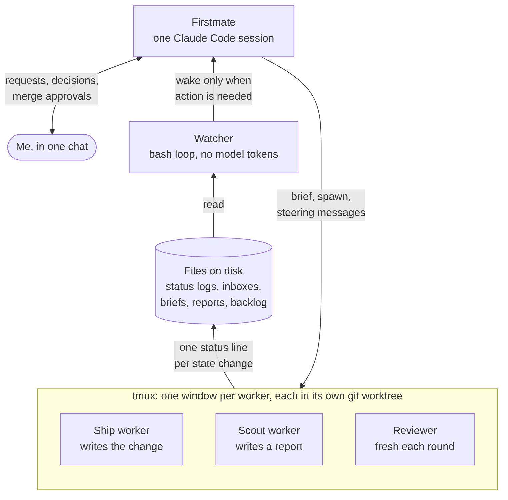
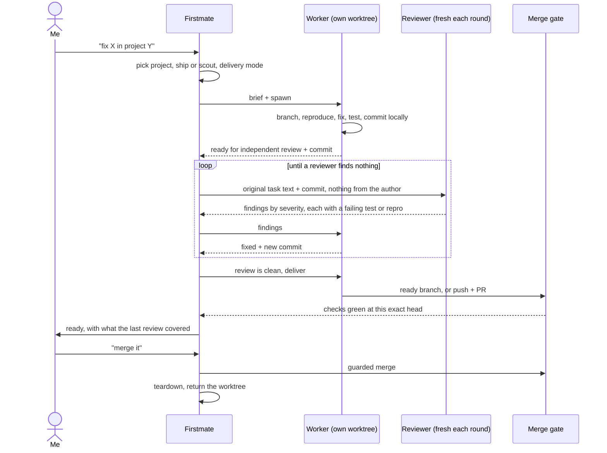
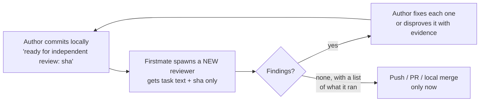

# How the setup works

This is how I run coding agents in parallel on one Mac. The orchestrator is [Firstmate](https://github.com/kunchenguid/firstmate), an open-source project by Kun Chen. I did not write it. I run it every day, I set the policies on top of it, and I fixed what broke for me in my own local commits (see [NUMBERS.md](NUMBERS.md)).

The work it runs is mostly client data-science projects, plus Firstmate itself and my own side projects.

## The pieces

- **Firstmate** is the only agent I talk to. It decides what kind of task a request is, writes a brief, spawns a worker, and tells me outcomes. It does not edit project code itself.
- **Workers** are separate Claude Code sessions, each in its own tmux window that I can watch or type into. Each gets a clean git worktree at a detached HEAD and creates its own branch, `fm/<task-id>`. It must check `pwd -P` and `git rev-parse --show-toplevel` first and stop if it landed in the main checkout.
- **Status lines** are the only way a worker reports: it appends one line such as `working:`, `paused:`, `needs-decision:`, `blocked:`, `done:` or `failed:` to its own log file.
- **The watcher** is a bash loop. It reads status logs and panes and wakes Firstmate only when a worker finished, needs a decision, failed, or looks stuck. Everything else it absorbs without spending model tokens.
- **Steering** goes the other way. Firstmate writes a message file into the worker's inbox and types one short doorbell line into its terminal. The worker acknowledges by moving the file. An unacknowledged message rings again.
- **Everything lives on disk.** If the Mac restarts or a session dies, the next Firstmate session rebuilds the fleet picture from `state/` and `data/`.

## From request to merged change

1. **Intake.** Firstmate resolves which project the request is about and asks one question if it cannot tell. It decides between a *ship* task (a change) and a *scout* task (a report in `data/<id>/report.md`, never code). It picks the delivery mode from the project's registered default.
2. **Brief.** The brief is a file. It holds my words verbatim under "intent", Firstmate's build constraints under "spec", and the fixed rules: setup, status vocabulary, steering inbox, and the definition of done for that mode.
3. **Spawn.** `bin/fm-spawn.sh` takes a worktree from the pool, opens a tmux window and starts the agent. It refuses to launch if the brief's delivery mode disagrees with the one passed to it.
4. **Work.** The worker reproduces the problem first, fixes it, and runs the repo's own lint and tests. It writes scratch and proof outside the worktree.
5. **Review loop.** Described below. This is the part I added on top of Firstmate.
6. **Deliver and merge.** Described under the gates.
7. **Teardown.** Teardown refuses a dirty worktree and refuses to return one whose committed work has not landed, unless I explicitly force it to discard that work.

## The review loop

Upstream Firstmate leaves review to the delivery path: either an automated pipeline (`no-mistakes`) or nothing extra. I added a stricter loop for every change, written as a skill that both the author worker and Firstmate follow.

The rules, and why each exists:

- **The author never reviews its own change**, and neither do its helper agents. They share its assumptions.
- **The reviewer never sees the author's notes or verdict.** A reviewer that inherits the author's framing checks what the author already believes.
- **A new reviewer every round.** A reviewer that approved a design keeps approving it.
- **The reviewer runs the code.** It runs the tests, breaks each new test on purpose to prove it can fail (a mutation check), and sweeps every sibling of any flaw it finds. "Looks good" without a list of what it ran does not end the loop.
- **Review happens before any human or bot reviewer sees the PR**, because each extra round there costs a person's time.

How many changes needed more than one round, and how many rounds they took, is in [NUMBERS.md](NUMBERS.md).

## The gates

A change has to pass all of these before it lands. Most are enforced by a script. Two are process rules the agents follow: the independent review loop and asking for my approval.

| Gate | What it checks | Enforced by |
|---|---|---|
| Isolation | Worker is in its own worktree, not the main checkout | Script: `fm-spawn.sh` refuses a non-isolated worktree. The brief also tells the worker to check before branching |
| Delivery mode | Brief and spawn agree on `local-only`, `direct-PR` or `no-mistakes` | `fm-spawn.sh` refuses a mismatch |
| Done | The commit the worker names is on the shared branch, not only in its disposable copy | `fm-dod-lib.sh` reachability check |
| Independent review | A fresh reviewer found nothing | Process rule: the review-loop skill that Firstmate and the workers follow |
| Pipeline (`no-mistakes` mode) | Automated review, tests, lint, docs, push, PR and CI | The `no-mistakes` tool |
| PR merge | PR is open, not a draft, mergeable, every check green at the current head, every required check has reported; the merge is bound to that head | `fm-pr-merge.sh` (live reads, then `gh pr merge --match-head-commit`) |
| Local merge (`local-only` mode) | Fast-forward only onto local `main` | `fm-merge-local.sh` |
| My approval | I approve every merge, except on the projects where I turned on auto-merge for green, in-scope work | Process rule: Firstmate asks me. The red-PR refusal is in `fm-pr-merge.sh` and holds even with auto-merge on, unless I waive a named check |
| Teardown | Worktree clean and its work landed | Script: `fm-teardown.sh` refuses otherwise, unless explicitly forced |

How I set the delivery modes across my registered projects: most run the full pipeline for product code and a lighter direct PR for internal tooling (`no-mistakes-prod-only`). Personal repos and experiments are `local-only`, where the worker hands back a ready branch instead of opening a PR. A few always run the full pipeline. Current counts are in [NUMBERS.md](NUMBERS.md).

## What I changed locally

Three kinds of change, all mine and none in upstream as of my last fetch:

- **Local commits to Firstmate's own scripts and tests.** The count, dates and breakdown are in [NUMBERS.md](NUMBERS.md). Most came out of a failure in [FAILURES.md](FAILURES.md).
- **The review loop above**, as a skill outside the Firstmate repo.
- **Standing rules added to every brief.** For example: prove it by running the real thing; check that a test suite actually ran something before trusting a green result; run the repo's whole lint gate, not just the tool you touched. Each rule is there because breaking it cost me real time.

Changes to Firstmate itself go through the same loop: a worker writes the fix on a branch, a fresh reviewer checks it, and I approve the fast-forward into my local `main`.
